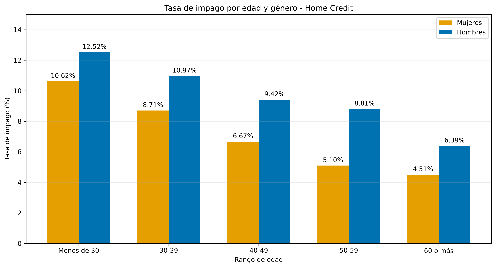
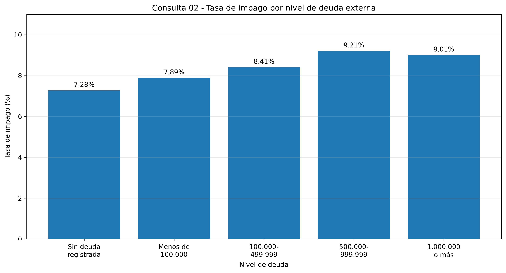
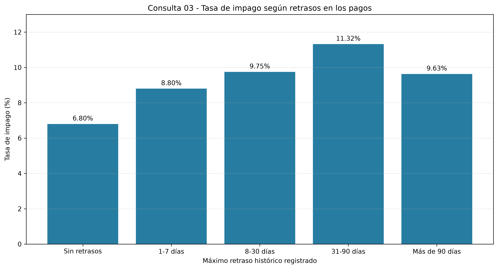
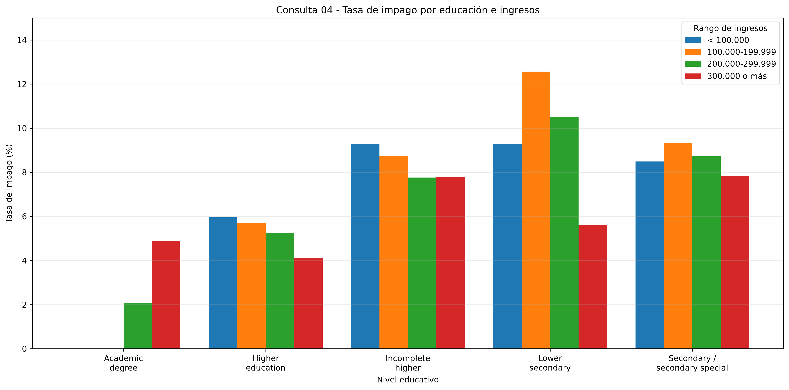
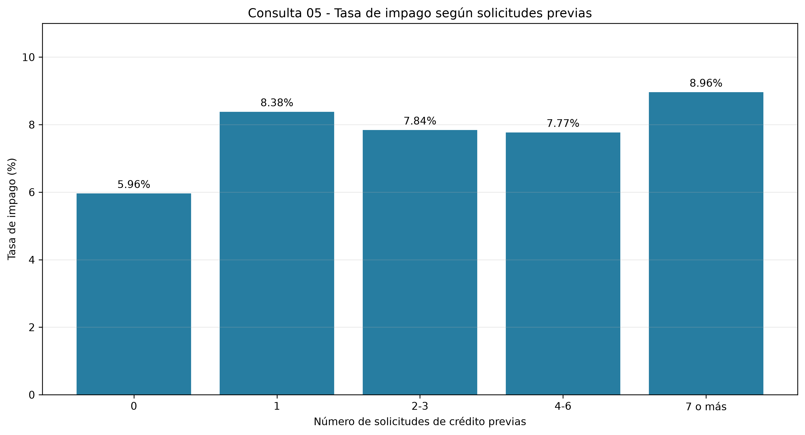
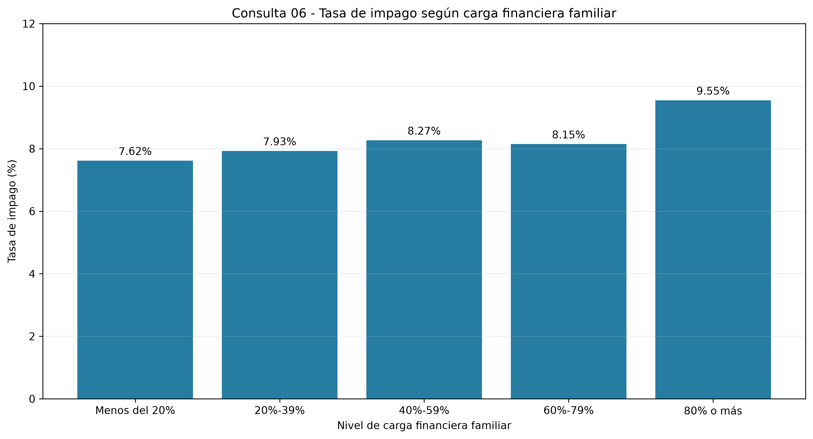
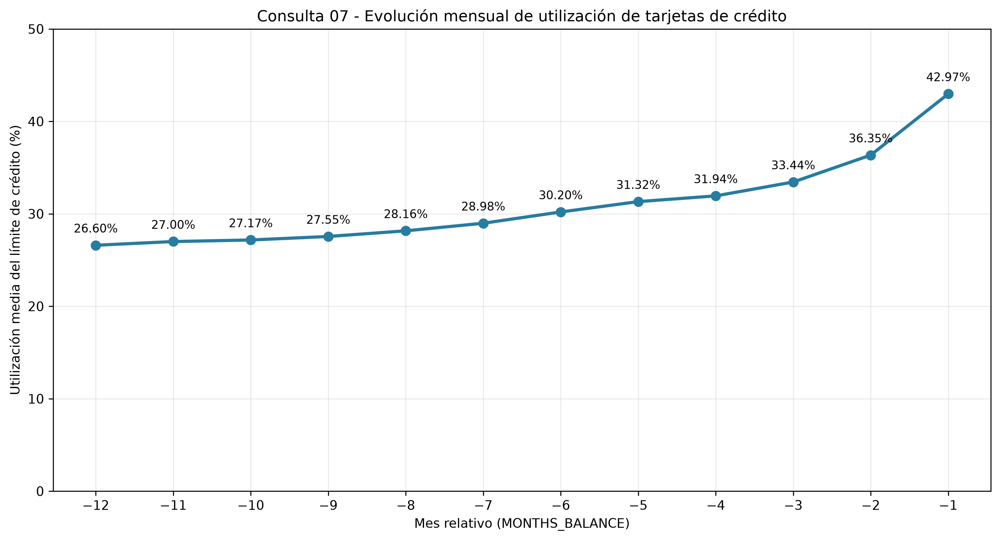
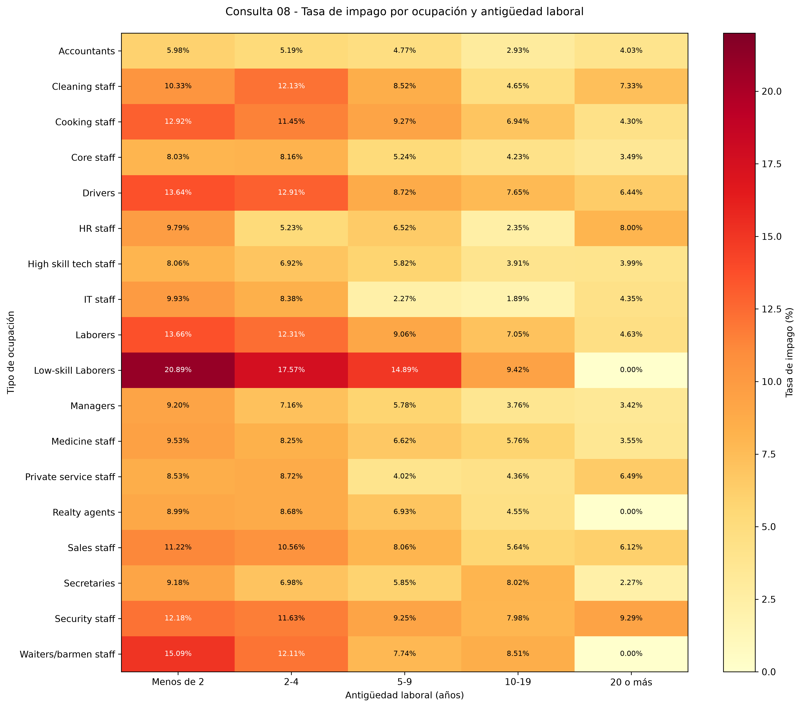
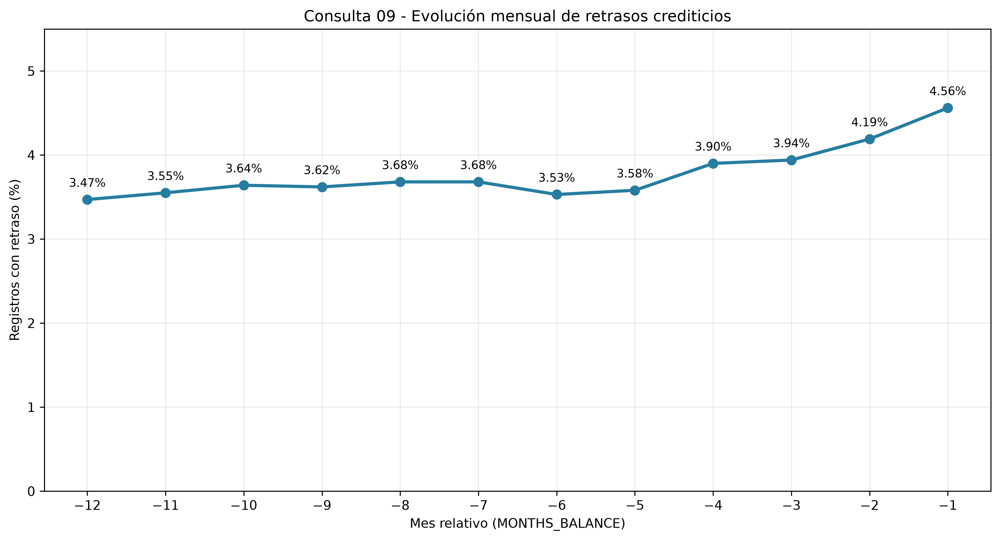
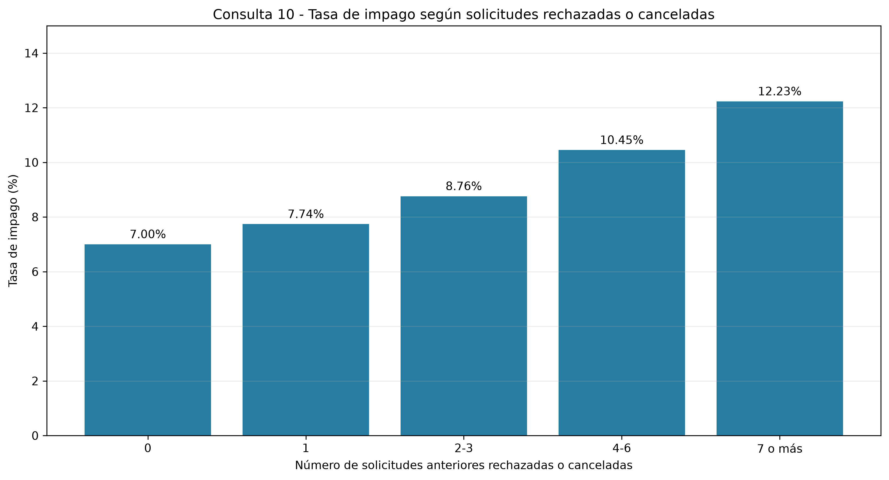

# PROYECTO BIGDATA-ATBD

## 1. Introducción y objetivos

El proyecto desarrolla un entorno distribuido para analizar datos
crediticios de Home Credit mediante Docker, Hadoop HDFS, YARN
y Apache Spark, inicialmente en local y posteriormente en AWS Academy.

El objetivo es implementar un clúster funcional de cinco nodos,
procesar diez consultas analíticas y validar sus visualizaciones.

## 2. Arquitectura distribuida

El proyecto BigData-ATBD se ha implementado inicialmente en un entorno
local basado en Docker y posteriormente se ha desplegado en AWS Academy.

La arquitectura de AWS utiliza cinco instancias EC2 t3.medium,
con dos vCPU y 4 GiB de memoria RAM cada una.

Cada instancia ejecuta un único contenedor Docker:

| Nodo | Servicios principales |
|---|---|
| Master | Hadoop NameNode y YARN ResourceManager |
| Worker1 | HDFS DataNode y YARN NodeManager |
| Worker2 | HDFS DataNode y YARN NodeManager |
| Worker3 | HDFS DataNode y YARN NodeManager |
| Client | Apache Spark y herramientas Hadoop |

La comunicación entre nodos utiliza las direcciones IP privadas
de AWS dentro de la misma red virtual.

## 3. Configuración del almacenamiento HDFS

HDFS distribuye los archivos CSV entre tres DataNodes y utiliza
un factor de replicación de tres.

El conjunto de datos Home Credit contiene diez archivos CSV,
con un tamaño conjunto de aproximadamente 2,5 GiB.

La comprobación mediante hdfs fsck confirmó:

- Estado del sistema: HEALTHY.
- Total de archivos: 10.
- Bloques validados: 27.
- Replicación media: 3.
- Bloques perdidos: 0.
- Bloques corruptos: 0.
- Bloques infrarreplicados: 0.

## 4. Procesamiento con YARN y Spark

El ResourceManager coordina los recursos de tres NodeManagers.

Las pruebas realizadas confirmaron que los tres nodos se
registraron en estado RUNNING.

Apache Spark 3.5.6 se ejecutó desde el contenedor cliente
utilizando YARN como gestor de recursos.

Se realizó una prueba distribuida de cálculo de Pi y se
comprobó la lectura de application_train.csv desde HDFS.

El archivo contiene 307511 registros y 122 columnas.

Posteriormente se ejecutaron diez consultas de análisis
de riesgo crediticio y se almacenaron sus resultados
en formato Parquet dentro de HDFS.

## 5. Validación de los resultados

Los resultados Parquet se exportaron a diez archivos CSV
para su comprobación en Windows.

Los valores obtenidos se contrastaron con las diez
visualizaciones realizadas mediante Python y Matplotlib.

Las diez gráficas coincidieron con los resultados
calculados en AWS, sin diferencias numéricas detectadas.

## 6. Consultas analíticas

### 6.01 Consulta 01. Impago por edad y género

Analiza la relación entre la edad, el género y la tasa de impago.
Utiliza application_train.csv y agrupa los clientes por rangos
de edad y género.

### 6.02 Consulta 02. Deuda externa e impago

Estudia la relación entre el endeudamiento registrado en otras
entidades y la tasa de impago. Combina información de solicitudes
con datos del historial crediticio mediante operaciones join.

### 6.03 Consulta 03. Retrasos en pagos e impago

Analiza cómo se relacionan los retrasos históricos en los pagos
con la probabilidad observada de impago. Utiliza operaciones de
agrupación y unión de datos por cliente.

### 6.04 Consulta 04. Educación, ingresos e impago

Compara las tasas de impago según el nivel educativo y el rango
de ingresos. Agrupa los clientes por ambas dimensiones.

### 6.05 Consulta 05. Solicitudes previas e impago

Estudia la relación entre el número de solicitudes crediticias
anteriores y la tasa de impago de los clientes.

### 6.06 Consulta 06. Carga financiera familiar e impago

Analiza la relación entre la carga financiera del cliente y
su tasa de impago, utilizando rangos de carga financiera.

### 6.07 Consulta 07. Utilización mensual de tarjetas

Calcula la utilización media de tarjetas de crédito durante
los doce meses anteriores, agrupando por MONTHS_BALANCE.

### 6.08 Consulta 08. Ocupación, antigüedad e impago

Compara la tasa de impago según el tipo de ocupación y la
antigüedad laboral, mediante una matriz de 18 ocupaciones
y cinco rangos de antigüedad.

### 6.09 Consulta 09. Evolución mensual de retrasos

Analiza la evolución de los registros con retrasos en los
doce meses anteriores, agrupando por MONTHS_BALANCE.

### 6.10 Consulta 10. Solicitudes no aprobadas e impago

Estudia la relación entre el número de solicitudes anteriores
rechazadas o canceladas y la tasa de impago observada.

### Ejecución y almacenamiento
Las diez consultas se ejecutaron mediante PySpark sobre YARN
en el clúster AWS de cinco instancias EC2.

Los datos de entrada se almacenaron en HDFS bajo /atbd/datasets/.

Los resultados se guardaron en formato Parquet bajo
/atbd/home_credit/results/consulta_XX.

Posteriormente se exportaron a CSV y se contrastaron con las
diez visualizaciones del proyecto, sin diferencias numéricas.

## 7. Conclusiones

El proyecto demuestra que es posible desplegar una arquitectura
de almacenamiento y procesamiento distribuido utilizando
Docker, Hadoop, YARN y Spark sobre instancias EC2 independientes.

La replicación triple de HDFS proporciona redundancia de
almacenamiento, y YARN permite gestionar los recursos
disponibles para las aplicaciones Spark.

Las diez consultas analíticas permitieron estudiar diferentes
factores relacionados con el riesgo crediticio utilizando
datos reales del conjunto Home Credit.

La coincidencia de los resultados entre el entorno local
y AWS valida la reproducibilidad de los análisis realizados.

Como limitación, el entorno AWS Academy utiliza recursos
temporales y máquinas con memoria limitada, por lo que
las aplicaciones se ejecutaron con configuraciones moderadas
de memoria y número de ejecutores.

## 8. Evidencias

Las evidencias de funcionamiento se encuentran en:

- evidencias/01_infraestructura/
- evidencias/02_hdfs/
- evidencias/03_yarn_spark/
- evidencias/04_resultados/

## 9. Anexos

Se conservan los scripts de Spark, las configuraciones Docker,
los CSV de origen, los resultados Parquet en HDFS y las gráficas PNG.
<!-- GRAFICAS_INTEGRADAS -->
